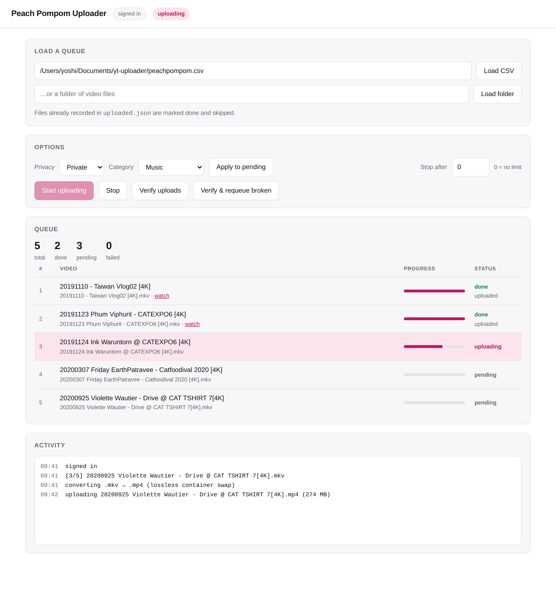

# Peach Pompom Uploader

A small tool for restoring a video archive to YouTube. It reads a list of local
video files plus their titles and descriptions, and uploads each one to your own
channel — resumable, one at a time, picking up where it left off.

Built to rebuild a channel after the original was lost. It has a browser UI and a
command-line interface; both share the same core.



## What it handles

- **Formats YouTube rejects.** `.mkv`, `.ts`, `.m2ts` and friends are re-wrapped
  into `.mp4` before upload — a lossless container swap, no re-encoding — and the
  temporary file is deleted afterwards, so disk usage never grows.
- **Interruptions.** Every success is recorded in `uploaded.json`. Run it again
  and it skips what's done.
- **Daily limits.** YouTube enforces both an API quota and a per-channel upload
  cap. When either is hit the tool stops cleanly and tells you, instead of
  burning through the rest of the queue on errors.
- **Silent rejections.** The API reports success as soon as the bytes land —
  *before* YouTube decides whether to accept the video. `--verify` asks what
  actually happened and can requeue anything that was rejected during processing.

## Setup

```bash
git clone https://github.com/intarotpharot-ui/peach-pompom-uploader.git
cd peach-pompom-uploader
python3 -m venv .venv && source .venv/bin/activate
pip install -r requirements.txt
brew install ffmpeg          # needed only for .mkv/.ts conversion
```

Then create an OAuth client:

1. In [Google Cloud Console](https://console.cloud.google.com/), enable **YouTube Data API v3**.
2. Create an OAuth client of type **Desktop app**.
3. Download the JSON and save it as `client_secret.json` in this folder.
4. If your consent screen is in *Testing*, add your channel's Google account under **Audience → Test users**.

`client_secret.json`, `token.json` and `uploaded.json` are gitignored. Keep them that way.

## The browser UI

```bash
python server.py
```

Opens `http://localhost:8756`. Point it at a CSV or a folder, set privacy and
category, and press Start. You get a live table with per-file progress, a running
log, and Stop / Verify buttons. The server binds to `127.0.0.1` only — nothing is
exposed to your network.

## The command line

```bash
# one video
python cli.py ~/Movies/clip.mkv --title "My title" --privacy private

# a whole list, six at a time
python cli.py --csv videos.csv --limit 6

# check what YouTube actually did with everything uploaded so far
python cli.py --verify
python cli.py --verify --requeue-failed
```

### CSV format

Only `file` is required. Relative paths resolve against the CSV's folder, or `--video-dir`.

```
file,title,description,tags,category,privacy,publish_at,playlist,thumbnail,made_for_kids
```

| Column | Notes |
|---|---|
| `category` | ID or name — `music`, `travel`, `gaming`, `howto`, … |
| `privacy` | `private` (default), `unlisted`, `public` |
| `publish_at` | RFC3339 UTC, e.g. `2026-09-01T12:00:00Z`. Forces private until then. |
| `playlist` | Playlist ID, or a title — created private if it doesn't exist |
| `thumbnail` | jpg/png. Requires a verified channel. |

## Bulk-editing titles and descriptions

Separate from uploading: `edit.py` pulls your channel into a spreadsheet, you
edit it in Excel, and it applies the changes back.

```bash
python edit.py --export sheet.xlsx     # channel → spreadsheet
#   edit the yellow columns in Excel; leave a cell blank to keep it as-is
python edit.py --preview sheet.xlsx    # exact before/after diff, sends nothing
python edit.py --apply sheet.xlsx      # apply, after a confirmation prompt
```

The export carries `video_id`, `url`, `file` and `current_title` for identity,
blank columns for the new values, and the current description, tags, category
and privacy alongside so you can see what you're changing from.

Rows are matched by `video_id` → `url` → `file` (via `uploaded.json`) →
`current_title`, whichever the sheet provides. A title that matches more than
one video is reported, never guessed.

Editable: `title`, `description`, `tags`, `category`, `privacy`, `publish_at`.
Leave a cell blank and that field is left untouched — the tool reads each
video's current snippet and overlays only what you filled in, so partial edits
can't silently wipe tags or descriptions.

An update costs 50 quota units against the default 10,000/day, so roughly 200
edits per day — far cheaper than uploading.

## Quota, in practice

An upload costs about **1,600 quota units**, against a default of 10,000 per day —
roughly six uploads daily. Separately, YouTube caps uploads per channel per day;
that one is not visible in the Cloud Console and is often the real bottleneck.
Verifying your channel at [youtube.com/verify](https://www.youtube.com/verify)
raises it, and also lifts the 15-minute video length limit that silently rejects
longer uploads.

## Layout

```
ytuploader/core.py   OAuth, remux, resumable upload, state, verification
ytuploader/metadata.py  channel export, row matching, diffing, videos.update
cli.py               command-line uploader
edit.py              bulk metadata editor (spreadsheet in, updates out)
server.py            local web server (stdlib only) with SSE progress
web/index.html       the UI, single file
```

## Licence

MIT — see [LICENSE](LICENSE).
